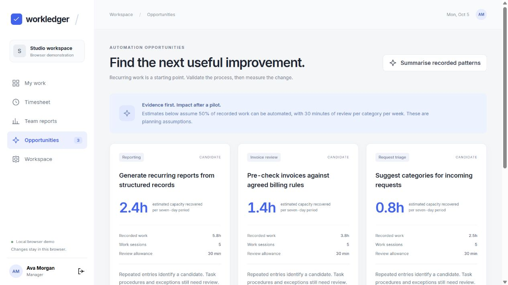

# Workledger

Task-linked time tracking, team reports, and evidence-backed automation opportunities.

[Try the browser demo](https://zulfkicar.github.io/apps/workledger/) · [Portfolio](https://zulfkicar.github.io/)



## What it does

Record work against tasks, inspect time by project and category, and identify recurring work worth investigating for automation. Every opportunity links to supporting tasks. Estimated recoverable time uses disclosed assumptions. Pilot measurements are recorded separately.

- Manager configuration for projects, time budgets, and team accounts.
- Tasks with owners, categories, estimates, due dates, statuses, and notes.
- Durable timers, manual work sessions, and removal of incorrect entries.
- Session authentication and backend-enforced member/manager permissions.
- Project, category, and team reports calculated from native SQLite records.
- Recurring-work candidates, supporting evidence, and pilot measurements.
- Scheduled UTC weekly briefs, durable slot deduplication, and run history.
- Optional Claude, OpenAI, or DeepSeek explanations of recorded facts.

## Run locally

Requires Node.js 24.14 or newer within the Node 24 release line.

```sh
npm ci
npm start
```

Open http://127.0.0.1:8770. All example records are synthetic.

| Account | Email             | Password        |
| ------- | ----------------- | --------------- |
| Manager | ava@example.test  | demo-workledger |
| Member  | noah@example.test | demo-workledger |

Records persist in `.data/workledger.sqlite`. Database files and `.env` are ignored by Git.

## Docker / Windows WSL

```sh
docker compose up --build -d
```

Run the command inside WSL on Windows, from this repository's directory. Open http://127.0.0.1:8870. A dedicated named volume persists records. The host port is loopback-only. The image uses an unprivileged user and a digest-pinned base image.

`docker compose stop` preserves the data volume.

## Optional AI

Copy `.env.example` to `.env`, then set `AI_PROVIDER`, `AI_MODEL`, and `AI_API_KEY`. Provider names are `anthropic`, `openai`, and `deepseek`. Choose a model available on your account. Default recorded-pattern mode performs no provider request.

The explanation receives a scoped set of recorded facts. Its output is schema-validated and cited task IDs must exist. Arithmetic and estimated impact remain application-controlled. A generated explanation can still require review.

Live paid provider calls were not performed for this release. Provider handling is tested with synthetic responses. The public browser demo uses no provider API.

## Start a blank workspace

Before the first startup against a new database, set `SEED_DEMO=0`, `ADMIN_NAME`, `ADMIN_EMAIL`, and `ADMIN_PASSWORD` (at least 12 characters). Existing records are never reset by changing these values.

The current app is a single-workspace MVP. Shared hosting additionally needs HTTPS, secure cookies, backups, and deployment-specific access controls. Do not reuse example credentials for a shared deployment.

## Verification

```sh
npm test
```

Tests exercise real HTTP sessions and permissions, cross-origin rejection, timer exclusivity, repeated stops, known-value report arithmetic, duplicate schedule ticks, and invalid AI evidence references. No paid API calls are made.

## Boundaries

- Browser demo: synthetic records in browser storage, with an explicit demonstration label. Server scheduling and external AI require the backend.
- Self-hosted app: real SQLite persistence, authentication, task/time operations, reports, and scheduled in-app briefs.
- Recurring categories are rules-based candidate discovery. They do not establish that a task can be automated.
- Pilot differences are observations, not causal estimates of business savings. Logged hours are not performance scores.
- Reports use UTC dates. Scheduled slots require the server to be running and do not catch up after downtime.
- Email delivery, automated app tracking, and a general workflow builder are outside this release.

## Structure

```text
server/     authentication, SQLite, analytics, optional AI, scheduled briefs
web/        browser interface and clearly labelled offline demonstration
test/       behavioral and HTTP integration checks
scripts/    synthetic fixture export from an isolated in-memory database
```

Only original implementation and synthetic example records are included.
